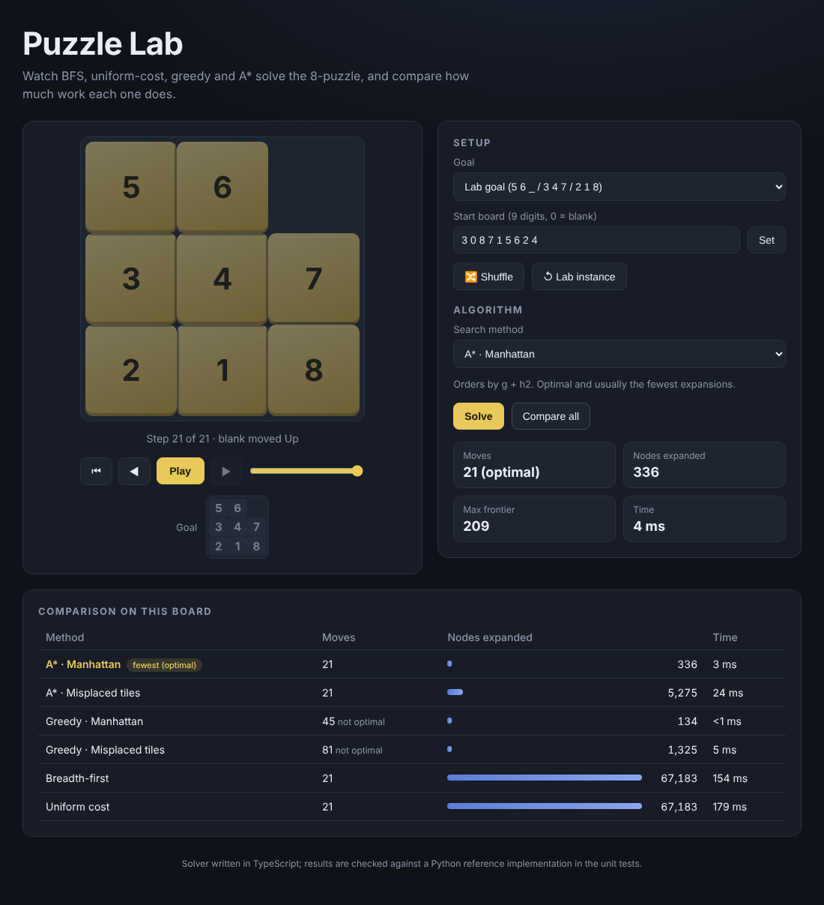

# Puzzle Lab — 8-puzzle search visualizer

An interactive React + TypeScript app that solves the 8-puzzle with several search
algorithms, animates the solution move by move, and compares how much work each
algorithm does on the same board.



## Features

- **Six algorithms:** A* (Manhattan / misplaced tiles), Greedy best-first (both heuristics), Breadth-first, Uniform-cost
- **Solution player:** play / pause, step forward and back, scrub with a slider; tiles that reach their goal position turn gold
- **Compare all:** runs every algorithm on the current board and shows moves, nodes expanded (as bars) and time
- **Playable board:** click a tile next to the blank to move it, shuffle to a random solvable board, or type your own start board
- **Parity check:** unsolvable boards are detected up front (inversion parity) instead of searching forever
- Two goal layouts: the classic `1 2 3 / 4 5 6 / 7 8 _` and the one from a university lab
- Responsive, keyboard accessible (real `<button>`s, focus rings, `aria-live` status, reduced-motion support)

## Example: the lab instance

`3 0 8 / 7 1 5 / 6 2 4` → `5 6 0 / 3 4 7 / 2 1 8`

| Algorithm | Moves | Nodes expanded |
|---|---:|---:|
| A* · Manhattan | 21 (optimal) | 336 |
| A* · Misplaced tiles | 21 (optimal) | 5,275 |
| Greedy · Manhattan | 45 | 134 |
| Greedy · Misplaced tiles | 81 | 1,325 |
| Breadth-first | 21 (optimal) | 67,183 |
| Uniform cost | 21 (optimal) | 67,183 |

## Tech

- React 19, TypeScript (strict), Vite
- No UI or state libraries: the solver is plain TypeScript in `src/lib/`
  - `puzzle.ts` — board model, moves, heuristics, solvability, shuffling
  - `heap.ts` — binary min-heap with FIFO tie-breaking
  - `solver.ts` — graph search with an explored set; all algorithms share one loop and differ only in the frontier priority
- Tile movement is a CSS `transform` transition on stable React keys, so the browser animates the slides
- **Vitest** unit tests. The solver results (path, node counts) are asserted to match the Python implementation in [puzzle8-search-solver](https://github.com/MirceaH/puzzle8-search-solver)

## Run locally

```bash
npm install
npm run dev      # http://localhost:5173
npm test         # unit tests
npm run build    # production build in dist/
```

## Deploy

A GitHub Actions workflow (`.github/workflows/deploy.yml`) runs the tests, builds with the
correct base path and publishes to GitHub Pages. Enable it under
**Settings → Pages → Source: GitHub Actions**.

## Possible next steps

- Run the search in a Web Worker so very hard boards never block the UI
- Add IDA* and a 15-puzzle mode
- Show the search frontier as it grows
